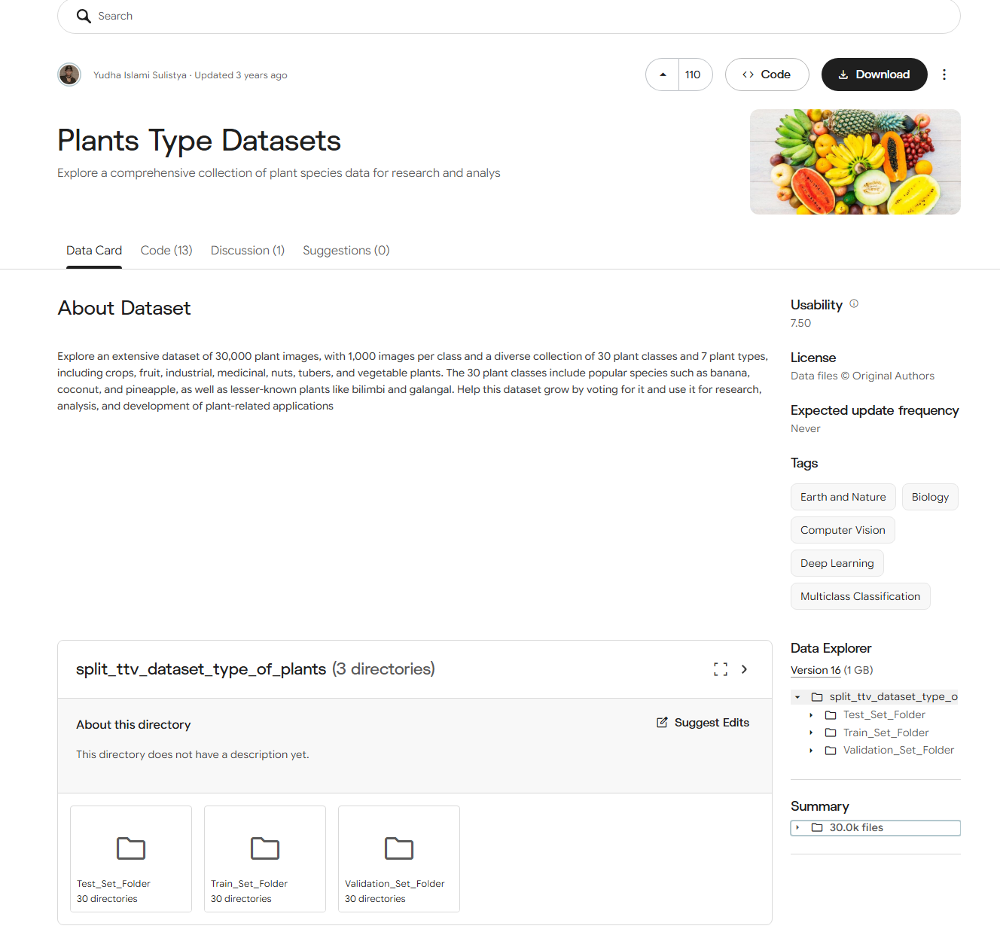
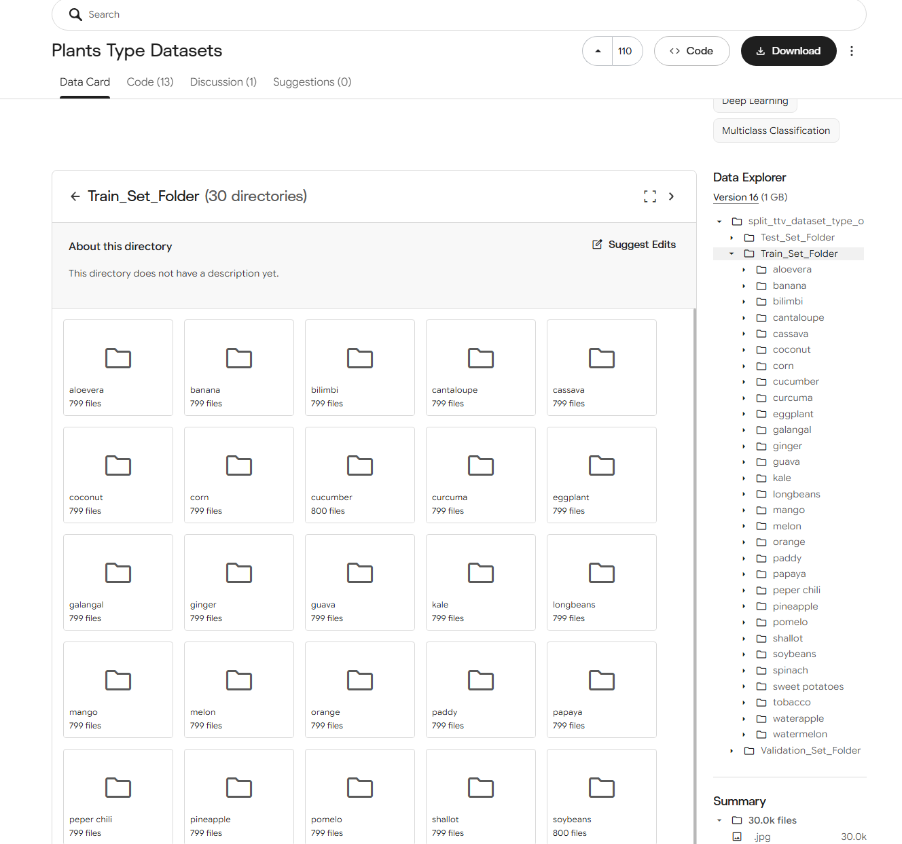
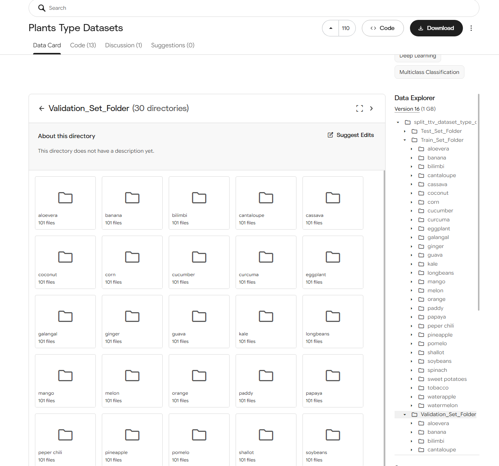

# Dataset: Fise de ingrijire pentru plante

**Curs:** Ingineria algoritmilor pentru AI  
**Echipa:** Avramescu Isaac, Poenaru Andrei, Radoi Dragos, Vasile Marina

## 1. De ce acest dataset?

Vom folosi **Plants Type Datasets** de pe Kaggle pentru a construi un set de fise simple de ingrijire, asociate plantelor din dataset. Acesta ofera imagini organizate pe clase, iar noi vom adauga informatii despre udare, lumina, sol si conditii de cultivare.

Ne propunem aproximativ **30 de fise**, in functie de identificarea plantelor din cele 30 de clase. Vom verifica denumirile inainte de a asocia fiecare clasa cu o planta, deoarece un nume comun poate avea mai multe sensuri.

Setul este destinat persoanelor care incep sa cultive plante acasa sau in gradina. Utilizarea propusa este simpla: **utilizatorul selecteaza o planta, iar aplicatia afiseaza fisa de ingrijire si sursele informatiilor**.

Ghiduri de ingrijire exista deja, insa pentru proiect avem nevoie de informatii organizate in acelasi format si asociate claselor din datasetul ales. Contributia echipei este selectarea, verificarea si reunirea acestor informatii. Nu urmarim sa inventam recomandari noi sau sa construim un sistem complex de recunoastere a imaginilor.

## 2. Surse

**Imagini si etichete:** [Plants Type Datasets - Kaggle](https://www.kaggle.com/datasets/yudhaislamisulistya/plants-type-datasets?select=split_ttv_dataset_type_of_plants), publicat de **Yudha Islami Sulistya**.

Conform paginii prezentate in capturile anexate:

- Datasetul are aproximativ **30.000 de imagini JPG**, organizate in **30 de clase**.
- **Versiunea 16** are aproximativ **1 GB**.
- Datele sunt impartite in `Train_Set_Folder`, `Test_Set_Folder` si `Validation_Set_Folder`.
- La licenta apare **"Data files © Original Authors"**. Imaginile nu vor fi republicate in repository deoarece nu mentioneaza permisiunea de distribuire.

**Informatii de ingrijire:** vom folosi ghiduri precum cele publicate de **Royal Horticultural Society (RHS)**. Pentru exemplele din document au fost consultate:

- **[S1 - RHS: plante care prefera lumina, inclusiv Aloe vera](https://www.rhs.org.uk/shows-events/rhs-urban-show/houseplant-profiles/houseplants-for-sunlight)**.
- **[S2 - RHS: cultivarea spanacului](https://www.rhs.org.uk/vegetables/spinach/grow-your-own)**.

## 3. Date sensibile

Fisele noastre nu au nevoie de date personale.

**Datele brute si imaginile nu vor fi incarcate pe GitHub.** Repository-ul va contine documentatia, fisele realizate de echipa si esantionul de metadate, in conditiile permise de sursa.

## 4. Schema si exemple

O inregistrare din setul final reprezinta **o fisa de ingrijire**. Vom folosi un tabel CSV cu urmatoarele campuri:

| Camp | Continut |
|---|---|
| `eticheta_dataset` | Denumirea exacta a clasei din Kaggle |
| `nume_planta` | Denumirea plantei, dupa verificare |
| `udare` | Recomandare scurta despre apa |
| `lumina` | Conditiile de lumina |
| `sol` | Tipul de sol sau substrat |
| `observatii` | Conditii importante pentru cultivare |
| `surse` | Linkurile care sustin recomandarile |

Informatiile care nu pot fi confirmate vor fi marcate "necunoscut". Recomandarile vor tine cont de conditiile de cultivare, fara un calendar presupus valabil in orice regiune.

**Exemple de fise propuse:**

| eticheta_dataset | nume_planta | udare | lumina | sol | observatii | surse |
|---|---|---|---|---|---|---|
| aloevera | Aloe vera | Substratul se lasa sa se usuce intre udari; udare redusa iarna | Loc luminos, insorit | Substrat cu drenaj bun | Protectie impotriva inghetului; excesul de apa poate afecta radacinile | S1 |
| spinach | Spanac | Solul se mentine umed; udare in perioadele secetoase | Umbrire usoara pe vreme calda | Sol fertil care nu se usuca | Caldura si seceta pot favoriza inflorirea prematura | S2 |

Etichetele sunt vizibile in capturile datasetului. Recomandarile provin din ghidurile RHS, nu din Kaggle. Pentru `spinach`, exemplul foloseste informatii despre *Spinacia oleracea*; asocierea botanica va fi verificata inainte de includerea in setul final.

**Esantion real - 30 de randuri**

Fiecare rand reprezinta metadatele unei imagini existente in dataset. Am selectat primele 15 in ordine alfabetica din fiecare dintre clasele `aloevera` si `banana`, din prima pagina a [listarii oficiale Kaggle](https://www.kaggle.com/api/v1/datasets/list/yudhaislamisulistya/plants-type-datasets?pageSize=1000&datasetVersionNumber=16).

| eticheta_dataset | nume_fisier | subset |
|---|---|---|
| aloevera | aloevera42.jpg | Test_Set_Folder |
| aloevera | aloevera434.jpg | Test_Set_Folder |
| aloevera | aloevera447.jpg | Test_Set_Folder |
| aloevera | aloevera458.jpg | Test_Set_Folder |
| aloevera | aloevera461.jpg | Test_Set_Folder |
| aloevera | aloevera462.jpg | Test_Set_Folder |
| aloevera | aloevera472.jpg | Test_Set_Folder |
| aloevera | aloevera480.jpg | Test_Set_Folder |
| aloevera | aloevera49.jpg | Test_Set_Folder |
| aloevera | aloevera561.jpg | Test_Set_Folder |
| aloevera | aloevera569.jpg | Test_Set_Folder |
| aloevera | aug_0_1116.jpg | Test_Set_Folder |
| aloevera | aug_0_1117.jpg | Test_Set_Folder |
| aloevera | aug_0_1125.jpg | Test_Set_Folder |
| aloevera | aug_0_1163.jpg | Test_Set_Folder |
| banana | aug_0_10.jpg | Test_Set_Folder |
| banana | aug_0_1022.jpg | Test_Set_Folder |
| banana | aug_0_1095.jpg | Test_Set_Folder |
| banana | aug_0_1109.jpg | Test_Set_Folder |
| banana | aug_0_1128.jpg | Test_Set_Folder |
| banana | aug_0_1169.jpg | Test_Set_Folder |
| banana | aug_0_1265.jpg | Test_Set_Folder |
| banana | aug_0_1274.jpg | Test_Set_Folder |
| banana | aug_0_137.jpg | Test_Set_Folder |
| banana | aug_0_141.jpg | Test_Set_Folder |
| banana | aug_0_1459.jpg | Test_Set_Folder |
| banana | aug_0_1487.jpg | Test_Set_Folder |
| banana | aug_0_1732.jpg | Test_Set_Folder |
| banana | aug_0_1767.jpg | Test_Set_Folder |
| banana | aug_0_1809.jpg | Test_Set_Folder |

## 5. Cum vom arata ca setul este util?

Pentru cateva plante vom verifica daca fisele permit gasirea raspunsurilor la intrebari simple despre apa, lumina si sol. Vom compara raspunsurile cu sursele si vom nota informatiile lipsa sau gresite. Evaluarea va fi realizata intr-o etapa ulterioara.
